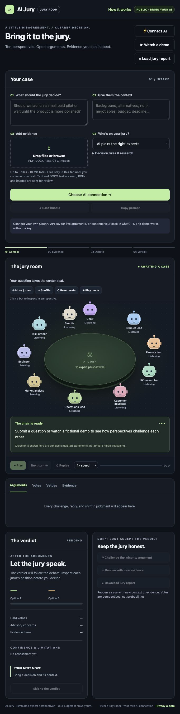
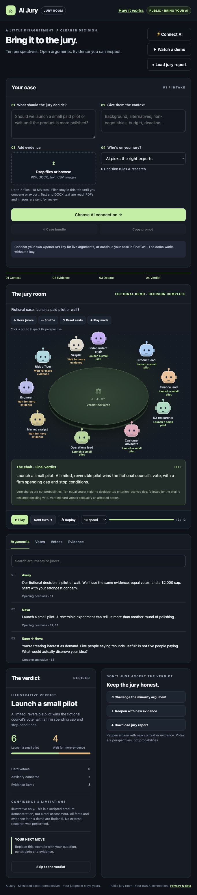
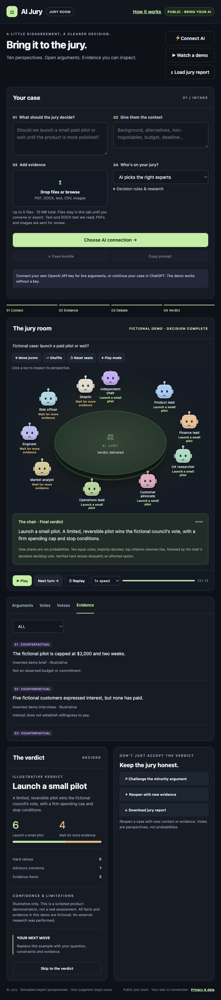

# AI Jury

**Bring a decision to ten simulated expert perspectives, watch their public arguments, and inspect the evidence behind the verdict.**

AI Jury is a browser-based decision room with animated jurors, file intake, streamed arguments, preliminary and final votes, veto review, and downloadable reports. Use it to compare actionable options, expose assumptions, preserve dissent, and decide what to investigate next.

The ten jurors are perspectives generated by **one AI model**, not ten independently running agents or human experts. Their statements are concise public explanations, not private model reasoning. A vote share is not a probability, and a majority does not establish factual truth.

## Screenshots of the running app

These are real browser captures of this repository running locally. The completed case uses the app's built-in **fictional demo**, not a live API assessment. No mockups or generated UI images are used. Open an image to inspect the full capture.

### Case intake and jury room



### Arguments and completed verdict

The scripted demo ends with six votes for a limited pilot and four for waiting. The verdict preserves the minority concern and identifies the evidence as fictional.



### Inspectable evidence

Evidence items retain their IDs, classifications, sources, dates, and limitations. The demo explicitly labels its invented evidence as COUNTERFACTUAL.



## Run locally

Requirements: **Node.js 22 or newer**, npm, and a modern browser. There are no third-party package dependencies, no database, and no server API key to configure.

```sh
git clone https://github.com/saminyeasirhasansyh-cell/AiJury.git
cd AiJury
npm run build
npm start
```

Open **http://localhost:10000**. `npm start` serves the generated build; rebuild after changing source files. To choose another port:

```sh
PORT=3000 npm start
```

Click **Watch a demo** to explore without credentials or API usage. The fictional demonstration and imported reports are labeled as playback.

## Three ways to use the room

| Mode | What happens | Requirements |
| --- | --- | --- |
| Live jury | The server requests a streamed, structured assessment from OpenAI and the room displays its public events. | Your own OpenAI API key with model access and available API billing/credits. |
| ChatGPT handoff | The app opens ChatGPT and copies or downloads a prepared prompt. Attach your original files there, request the JSON report, then load it back into the room. | Access to ChatGPT; no key is needed for playback here. |
| Demo / report playback | Watch the built-in fictional case or load a compatible report JSON file. | No API key. Imported reports must be under 5 MB and pass validation. |

The ChatGPT handoff does not connect a ChatGPT subscription to live generation on this website. The live path uses API billing on the visitor's account. Setting a key in the dialog checks its format; the provider checks it when you convene the jury.

## Walk through a decision

1. **Describe the decision.** Ask a concrete question and provide background, alternatives, budget, deadline, and non-negotiable requirements.
2. **Attach evidence.** Drop files into the intake area or browse for them. You can remove attachments before submitting.
3. **Choose perspectives.** Let AI select the experts, specify your own roles, or combine the two. The generation instructions require exactly ten distinct perspectives, including an independent chair and a skeptic.
4. **Set the rules.** Expand **Decision rules & research** to define the most important criteria, evidence scope, and hard-veto requirements.
5. **Connect and convene.** Choose **Connect AI**, enter your key for this tab, and submit the case. Without a key, preparing a case offers connection and ChatGPT handoff options; **Case bundle** and **Copy prompt** become available.
6. **Review the exchange.** Watch or pause the arguments, step through turns, change playback speed, search the argument log, and click jurors to inspect their perspectives.
7. **Inspect the result.** Review **Votes**, **Vetoes**, and **Evidence**, plus the verdict's confidence, limitations, and next action. You can skip to the verdict once a report is available.
8. **Challenge or reopen.** The minority-challenge and new-evidence buttons append follow-up context to the case. Review it, add evidence, and explicitly reconvene; those buttons do not automatically launch another request.
9. **Save a report.** Download the report JSON for later inspection and replay with **Load jury report**. Case bundles contain the prepared inputs and encoded attachments; they are different from finished jury reports.

**Move jurors**, **Shuffle**, and **Reset seats** change the seating arrangement. **Play mode** adds playful bot interactions. These controls do not change the case evidence or voting rules. Seat positions persist as a browser preference.

## How the council reaches a verdict

The model instructions ask the chair to inspect the case, state decision rules, and select meaningful options: normally two, or up to six for a supplied selection. When essential missing context prevents a responsible recommendation, the model can return up to three clarification questions instead of a verdict.

A normal assessment establishes the council and preliminary votes, records evidence, and produces public turns covering opening positions, challenges and replies, minority concerns, red-team review, final defense, and voting. The prompt requests 12–20 concise turns, with every juror speaking; these are generation instructions, not a guarantee that every semantic requirement is independently enforced by code. Vote changes should reflect the arguments rather than be manufactured for drama.

The declared rules are ten equal votes with no abstentions, majority decision, then predefined criteria and the chair's declared deciding vote for a tie. Initial and final votes remain separately visible.

- **Hard veto:** disqualifies an option only when active and verified, with a predefined non-negotiable rule, supporting evidence IDs, and chair review.
- **Advisory veto:** records a concern and mitigation without automatically overriding the tally.
- **All options disqualified:** the permitted verdict is `No admissible option`.

The validator checks report structure, option and juror references, evidence references, and hard-veto consistency. It does **not** independently prove claims, verify sources, or recalculate every majority/tie-break decision. Review the tally and explanations yourself.

## Evidence and research

| Classification | Intended meaning |
| --- | --- |
| `FACT` | Directly established information. |
| `REPORTED` | An unverified source or user report. |
| `INFERENCE` | A conclusion drawn from other evidence. |
| `ASSUMPTION` | A premise used without establishing it. |
| `UNKNOWN` | A material gap in knowledge. |
| `COUNTERFACTUAL` | A hypothetical or invented premise, including demo evidence. |

Each item carries an ID, claim, source, date, limitations, and optional HTTP(S) source URL. Arguments and juror explanations cite those IDs. Classification itself is model-generated and can be wrong; readable documents are not automatically independently verified.

The evidence-scope choices are **Supplied evidence only**, **Evidence + general knowledge**, **Current verified research**, and **Comprehensive review**. The last two enable OpenAI's `web_search` tool. A selected research mode alone does not prove research occurred: the gateway tracks completed search calls and replaces the report's external-comparison text with a no-external-research notice when none occurred. General knowledge is not externally verified.

### Attachments and limits

Up to **5 files**, **10 MB combined**:

| Formats | Processing |
| --- | --- |
| TXT, MD, CSV, JSON | Decoded as UTF-8 text; up to 100,000 characters per file. |
| DOCX | Browser extracts document text; images and layout are not reviewed. Extracted text is limited to 100,000 characters. Unsupported compression/browser support may require a PDF or text version. |
| PDF | Sent as an OpenAI input file. |
| PNG, JPG/JPEG, WebP | Sent as image inputs after basic signature checks. |

The question is limited to 12,000 characters; the context field in the UI is limited to 40,000. The gateway caps the complete JSON request at 15 MB, so a case near the attachment limit can still require shortening because encoded files add overhead.

## Architecture and request flow

```text
Browser: case + files + visitor key
        |
        | POST /api/deliberate (same origin)
        v
Node HTTP server -> request/attachment validation
        |
        | OpenAI Responses API, streaming structured JSON
        v
Council -> evidence -> public turns -> validated report
        |
        | newline-delimited JSON events
        v
Browser: animated room, review tabs, verdict, JSON export
```

The current model is `gpt-5.4-mini`, declared in `worker/handler.mjs`. Live deliberation is one Responses API request using the system instructions and strict JSON schema from `worker/model-config.json`, `stream: true`, `store: false`, and a 16,000 output-token limit.

The gateway parses fragmented provider events, emits council/evidence/turn updates, derives reply links from a target juror's latest earlier statement, and retains the final report until the provider stream completes and validation passes. Interrupted or invalid output produces an error rather than a validated final verdict. Cancellation propagates upstream.

| Path | Purpose |
| --- | --- |
| `src/index.html` | Page structure, styles, responsive layout, and dialogs. |
| `src/app.js` | Intake, DOCX text extraction, room animation, playback, validation, demo, and export. |
| `worker/handler.mjs` | Routes, input validation, OpenAI gateway, streaming parser, and security headers. |
| `worker/model-config.json` | Council instructions and structured-output schema. |
| `scripts/build.mjs` | Bundles HTML, script, shared validation, and configuration into `dist/server/index.js`. |
| `scripts/start.mjs` | Node HTTP adapter, health check, proxy-origin handling, and graceful shutdown. |
| `scripts/test.mjs` | Automated gateway checks using mocked provider responses. |
| `fixtures/live-fixture.json` | Fictional event fixture for tests; not a live assessment. |
| `render.yaml` | Render deployment Blueprint. |
| `docs/screenshots/` | Real captures of the running application. |

Routes: `GET /` (or `/index.html`), `GET /app.js`, `GET /healthz`, `GET /api/session`, and `POST /api/deliberate`. The session route reports visitor-key mode; it does not create a stored user session. Deliberation accepts JSON with an `X-Jury-Api-Key` header and rejects a mismatched Origin when supplied.

## Privacy and credentials

The application keeps the visitor key in tab memory, forwards it per deliberation through the site server to OpenAI, and does not save it in browser storage or a database. Refreshing, closing, or disconnecting the tab clears the key. There is no creator-key fallback.

Questions, files, and generated reports also live in tab memory until submitted or exported. Only seat positions are saved in local storage. Exported bundles include attachment contents, and downloaded reports remain wherever you save them.

OpenAI processes submitted case data; `store: false` is a request setting, not a promise of zero retention under every provider policy. Hosting infrastructure may retain ordinary request metadata. The application does not deliberately log case contents or credentials. Use HTTPS for hosted deployments: the server receives the visitor key in transit to the provider, so visitors must trust the host.

The gateway supplies a content security policy, no-store responses, safe evidence-link checks, sanitized provider errors, and upload validation. The repository does not implement a database, accounts, a shared persistent case library, or application-level rate limiting.

## Deploy on Render

Use the included `render.yaml` Blueprint, or create a Node web service with:

| Setting | Value |
| --- | --- |
| Build command | `npm run build` |
| Start command | `npm start` |
| Health check | `/healthz` |
| Node | 22+; Blueprint pins `24.13.0` |
| Port | Render supplies `PORT`; local default is `10000` |

The server binds to `0.0.0.0`, handles Render's forwarded HTTPS scheme, streams responses, forwards cancellation, and handles `SIGTERM`. No database or server-side OpenAI secret is required. Visitors supply their own keys in the UI.

## Validation and troubleshooting

```sh
npm run build
npm test
```

Build before testing because the tests import the generated server. Tests cover the public page, missing-key rejection, cross-origin rejection, invalid uploads, fragmented streaming, server-derived reply links, final-report delivery, and sanitized provider errors. They use fictional fixtures and mocked responses, with no real key or paid API request. They do not establish live model access or research quality.

| Symptom | What to check |
| --- | --- |
| Missing generated server or stale UI | Run `npm run build` again, then restart the server. |
| Key rejected | Reconnect with a valid key; a key is checked by OpenAI only when used. |
| Project cannot access the model | Check the API project's model permissions for the model configured in the gateway. |
| Usage limit / no credits | Check that API account's billing and limits; ChatGPT access does not supply this website's API usage. |
| DOCX cannot be read | Try a supported modern browser, PDF, or UTF-8 text excerpt. |
| Upload/request too large | Reduce file sizes, attachment count, or context; encoded request size matters too. |
| Interrupted stream / no final verdict | Review any partial arguments, then retry a shorter case. A partial debate is not a completed report. |
| Report import fails | Use a report JSON object, not a case bundle or the live `{events: [...]}` envelope; remove Markdown fences and ensure valid jurors, options, and evidence references. |

AI Jury is a tool for structured reflection. Its simulated perspectives can share errors and biases, and its verdict still requires your judgment.
